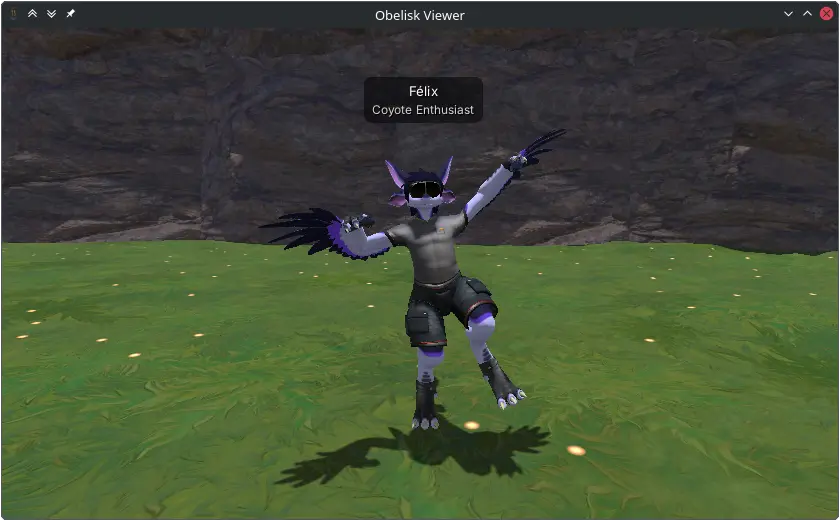

# Obelisk Viewer

Obelisk Viewer is an independently developed, VR-first third-party viewer for accessing Second Life®.

This isn't a replacement for the official viewer or other third party viewers, it's intended to be it's own thing to view Second Life in VR, where as if you want the full experience, you should use the official or another third party viewer.

## Features:
* VR tracking (Headset and hands)
* Menus accessible through VR
* Controller pie menus! (Probably needs redesign)
* Audio (Objects and Parcel Media)
* Voice (WebRTC, nearby): V or the pie menu turns your microphone on and off
* Media on a Prim: web pages and WebM video on objects, with sound (Windows: being tested)

## Coming soon:
* Group and private voice calls

## FAQ:
### How closely do you track the official viewer?
We try to stay as close as possible to the rendering and feature set of the main viewer.
For obvious reasons, we omit some features that won't work in VR, such as building, avatar editing, and so on.
We may in the future attempt these features, but they are out of scope for now.

### Do other people see my limb movements?
Not yet, at least, we can't without breaking Shared Experience. As much as we'd love to, we will need to coordinate with Linden Lab to work a method that works on all viewers.

### Can I connect to other grids?
We only officially support the two main Second Life grids, known as "Agni" and "Aditi".

You can select a different grid by using the `--grid` command line option.

OpenSim is not supported.

### Can I request features or report a bug?
Please feel free to request them by [opening an issue]() or by joining our [Discord server]()!

### What platforms does it work on?
We currently support Windows and Linux. Mac support should in theory work, but we have no Mac developer. If you wish to pick this up, please feel free reach out to us regarding this!

### What are the requirements?
* A VR headset is required to use VR - Though desktop support is there, it is VR first and may feel a bit awkward.
* SteamVR - Currently the viewer only works through SteamVR. It is written to use OpenXR, so other headsets may work, but we have only tested SteamVR.

The viewer starts in VR if SteamVR is installed and a headset is connected, and on the desktop otherwise. To choose yourself, use the `--force-vr` or `--force-desktop` command line option. Other OpenXR runtimes need `--force-vr`.

### How much AI is used in this project?
A majority of the commits are done with the help of an AI in order to help speed stuff along and summarize commit messages.

We understand some people may not approve of the use of AI, so we want to be forthcoming with our usage of it. If you have any questions, please feel free to reach out to us.

All AI written code is thoroughly tested.

**There is no AI integration in the viewer**. We have no plans of integrating AI into the viewer it's self.

## Third-Party Viewer Notice

Obelisk Viewer is developed in accordance with the [Second Life Third-Party Viewer Policy](https://secondlife.com/corporate/third-party-viewers), as established by Linden Research, Inc. ("Linden Lab").

Obelisk Viewer is **not provided or supported by Linden Lab, the makers of Second Life**. It is not affiliated with, endorsed by, sponsored by, or otherwise associated with Linden Lab or Second Life.

Second Life® is a trademark of Linden Research, Inc. All rights reserved. The Second Life name is used solely to identify the virtual world service with which this viewer is compatible.

Obelisk Viewer is an independent project and is not an official Second Life product. Linden Lab is not responsible for the development, distribution, maintenance, or support of Obelisk Viewer.

For information regarding Obelisk Viewer, its development, or technical support, please refer to this repository and its associated project resources.